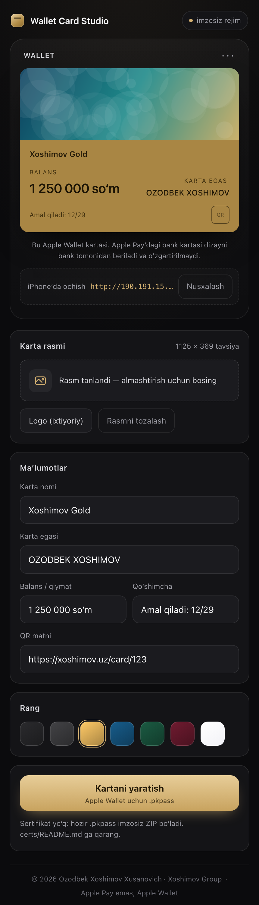

# Wallet Card Studio

Apple Wallet uchun o‘z rasmingiz bilan karta yasaydigan kichik veb-vosita. Telefon brauzerida ochiladi: rasm yuklaysiz, matn va rangni tanlaysiz, tayyor `.pkpass` faylni olasiz.



## Muhim: Apple Pay kartasi haqida

Apple Pay’dagi **bank kartasining rasmi va dizayni emitent bank tomonidan beriladi**. iOS’da foydalanuvchi uni almashtira olmaydi — na sozlamada, na ochiq API’da bunday imkoniyat bor. Internetdagi “Apple Pay karta rasmini o‘zgartirish” ko‘rsatmalari jailbreak yoki soxta skrinshot bilan ishlaydi.

Bu vosita boshqa narsa qiladi: Wallet’da sizga tegishli **yangi karta (storeCard pass)** yaratadi — fon rasmi, logotip, rang, matn va QR bilan. U bank kartangizning yonida turadi va iPhone’ga o‘rnatiladi.

## Imkoniyatlar

- Rasm: drag & drop yoki fayl tanlash; 1125 × 369 strip va ikonkalar avtomatik kesiladi
- 7 tayyor rang palitrasi, logotip va QR matni
- Jonli Wallet ko‘rinishi
- `.pkpass` generatsiyasi — sertifikat bo‘lsa imzolangan, bo‘lmasa imzosiz ZIP
- Tashqi kutubxonalarsiz: faqat Node.js va `openssl`

## Ishga tushirish

```bash
npm start
```

Brauzerda: <http://localhost:4173>

Node 18+ kerak. Telefonda ochish uchun Mac bilan bitta Wi-Fi’da bo‘ling va terminalda chiqqan `http://<IP>:4173` manzilini Safari’da oching (manzil sahifaning yuqori qismida ham ko‘rinadi).

## iPhone’ga o‘rnatish

1. `certs/README.md` bo‘yicha Pass Type ID sertifikatini qo‘shing.
2. Studioda kartani yarating — `.pkpass` yuklab olinadi.
3. Faylni iPhone’ga o‘tkazing (AirDrop, Files yoki Safari orqali yuklab olish) va bosing → **Wallet’ga qo‘shish**.

Sertifikat bo‘lmasa fayl `karta-imzosiz.zip` bo‘ladi. Uni ochish mumkin, lekin iOS imzosiz passni qabul qilmaydi — bu kutilgan holat.

## Tuzilma

```
server.js          HTTP server, /api/status va /api/pass
lib/pkpass.js      pass.json, manifest, ZIP writer, openssl bilan imzolash
public/            mobil-first interfeys (HTML/CSS/JS)
certs/             sertifikatlar va sozlama (git’ga tushmaydi)
```

Pass ichida: `pass.json`, `manifest.json`, `signature` (imzolangan bo‘lsa), `icon*`, `logo*`, `strip*` (1x/2x/3x).

## Cheklovlar

- Faqat `storeCard` tipidagi pass.
- To‘lov qabul qilmaydi va Apple Pay tranzaksiyalariga hech qanday aloqasi yo‘q.
- `.pkpass` faylini begonalarga tarqatmang: ichida siz kiritgan matn va QR bo‘ladi.

## Litsenziya

MIT © 2026 Ozodbek Xoshimov Xusanovich (Xoshimov Group)
